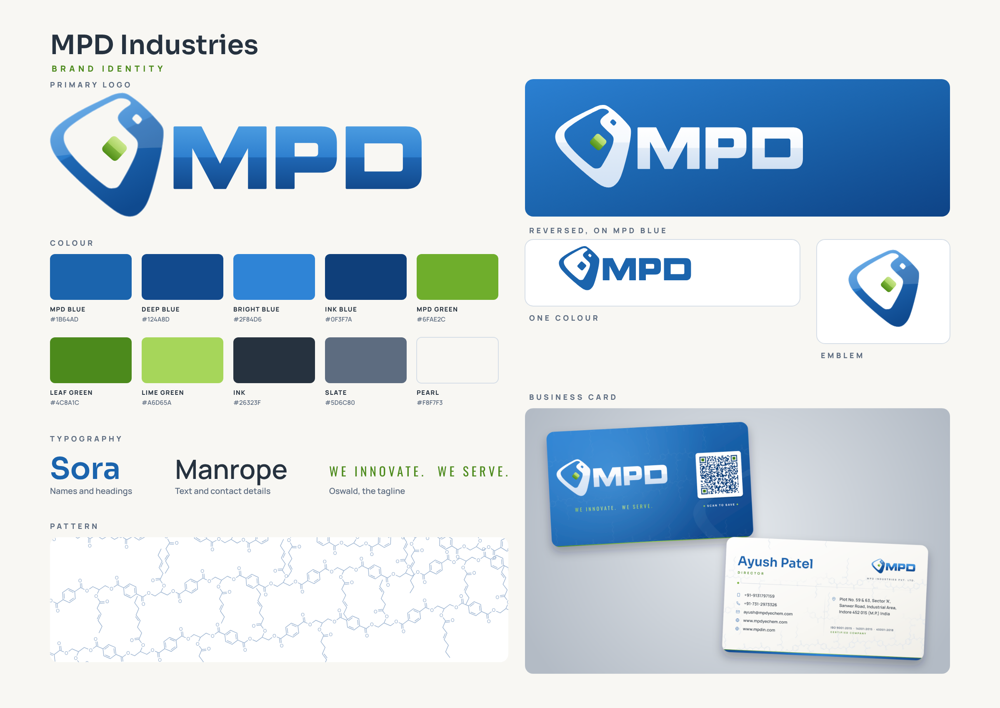

# MPD Industries brand identity

One place for the MPD logo files, colours, typefaces, pattern and the business-card system.
`brand-board.png` shows everything on one page.



Everything here is generated from the vectorised logo by `build_brand.py`:

```bash
python3 brand-identity/build_brand.py
```

It needs the same tools as the card generator (`pip install -r business-cards/requirements.txt`, plus Node with
Playwright for the PNG exports).

## Logo

| File | Use it for |
|---|---|
| `logo/mpd-logo.svg` | The primary logo, full colour. Light backgrounds: documents, website, signage. |
| `logo/mpd-logo-tagline.svg` | Primary logo with "WE INNOVATE. WE SERVE." underneath, as in the original artwork. |
| `logo/mpd-logo-white.svg` | Reversed logo for MPD Blue or other dark backgrounds. The green diamond stays green. |
| `logo/mpd-logo-mono-blue.svg` | One-colour logo in MPD Blue: one-colour printing, embroidery, rubber stamps. |
| `logo/mpd-logo-mono-black.svg` | One-colour logo in black: fax, newsprint, engraving, black-only printing. |
| `logo/mpd-emblem.svg`, `mpd-emblem-white.svg` | The emblem alone: app icons, favicons, social avatars, small spaces. |
| `logo/mpd-wordmark.svg` | The letters alone, for when the emblem already appears nearby. |

Every SVG has a matching transparent PNG at 4096 px and 1024 px wide (`-4096.png`, `-1024.png`).
Use the SVG wherever the software accepts it: it stays sharp at any size.

These files are a faithful vector redraw of the original raster logo. The MPD letters were rebuilt as clean
geometric shapes and the emblem was traced and smoothed, so they may differ very slightly from the original artwork.

**Clear space.** Keep empty space around the logo at least the height of the green diamond on every side.

**Minimum size.** Full logo at least 25 mm wide in print or 120 px on screen. Below that, use the emblem alone
(at least 8 mm or 32 px).

**Don't:** stretch or squash the logo, recolour parts of it, add shadows or outlines, rotate it, or place the
full-colour version on a busy photo or a mid-blue background. Use the reversed version on blue.

## Colour

| Name | Hex | RGB | Use |
|---|---|---|---|
| MPD Blue | `#1B64AD` | 27 100 173 | Primary. Logo, headings, the blue side of the business card. |
| Deep Blue | `#124A8D` | 18 74 141 | Dark end of gradients, footer bands. |
| Bright Blue | `#2F84D6` | 47 132 214 | Light end of gradients, highlights. |
| Ink Blue | `#0F3F7A` | 15 63 122 | QR codes and small text on light grounds. |
| MPD Green | `#6FAE2C` | 111 174 44 | Accent: the diamond, rules, small markers. |
| Leaf Green | `#4C8A1C` | 76 138 28 | Green for text on white (job titles, labels). |
| Lime Green | `#A6D65A` | 166 214 90 | Green on blue backgrounds (the tagline on the card). |
| Ink | `#26323F` | 38 50 63 | Body text. |
| Slate | `#5D6C80` | 93 108 128 | Secondary text and captions. |
| Pearl | `#F8F7F3` | 248 247 243 | Warm off-white background. |

`colour/palette.json` and `colour/palette.css` hold the same values for software and websites.
The CMYK figures in `palette.json` are simple estimates without a colour profile. For print, match MPD Blue and
MPD Green to the logo on a printed proof.

## Typography

| Typeface | Role |
|---|---|
| **Sora** | Names and headings |
| **Manrope** | Text, contact details, captions |
| **Oswald** | The tagline, always in spaced capitals |

All three are free Google Fonts under the SIL Open Font Licence. The font files and licences are in
`business-cards/fonts/`.

## Pattern

`pattern/alkyd-pattern-blue.svg` (on Pearl) and `pattern/alkyd-pattern-white.svg` (transparent, for MPD Blue) are
a line-art network of alkyd resin in skeletal-formula style: polyester backbones of phthalate rings and glycerol
joined by ester links, with drying-oil fatty-acid side chains. Use it as a quiet background texture only, at low
contrast, and keep it away from text and the logo. It is generated by `business-cards/molecules.py`.

## Business cards

Generated by `business-cards/generate.py` from `business-cards/people.csv`; see `business-cards/README.md`.
The finished cards are in `business-cards/cards/`.

- 89 x 51 mm, landscape, full colour both sides.
- Logo side: MPD Blue with the reversed logo, the tagline and a white QR tile captioned "SAVE CONTACT". The QR
  saves name (with the post in brackets), company, mobile and email as a phone contact.
- Details side: Pearl, with the name, title, logo, contacts, address and ISO certifications.
- Print on the heaviest matte stock available (400 gsm or more), with 3 mm rounded corners, from the `-print` files
  (3 mm bleed). Always approve a printed proof and scan its QR code with a phone first.
