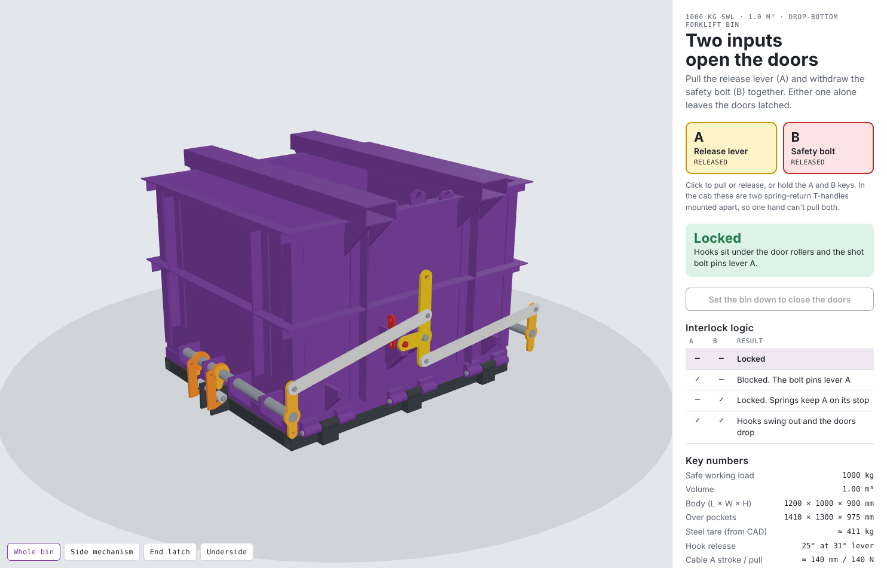
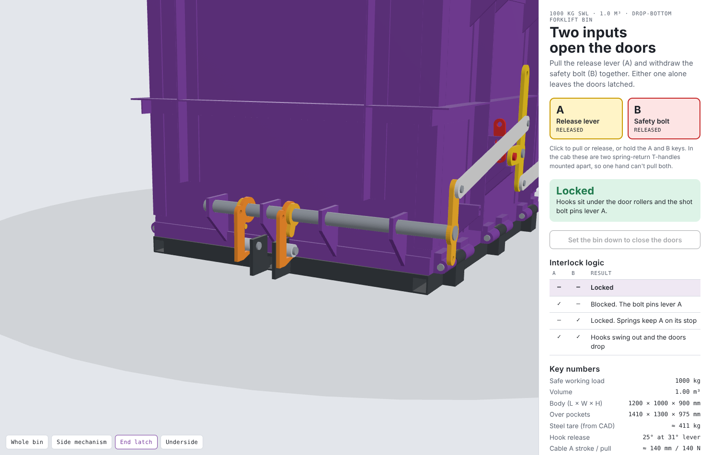
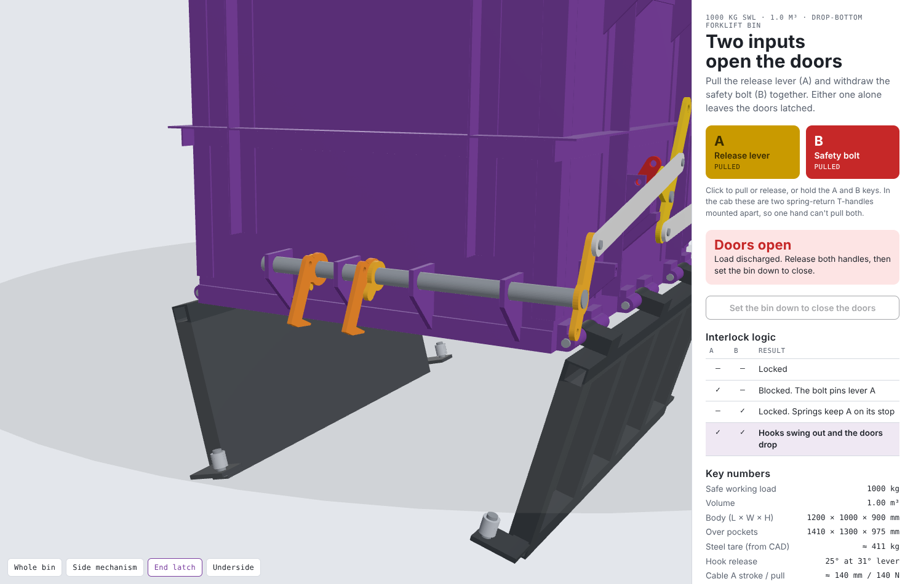
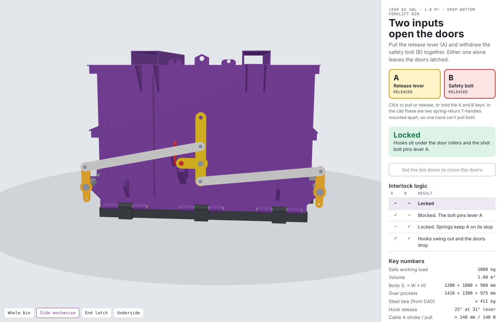
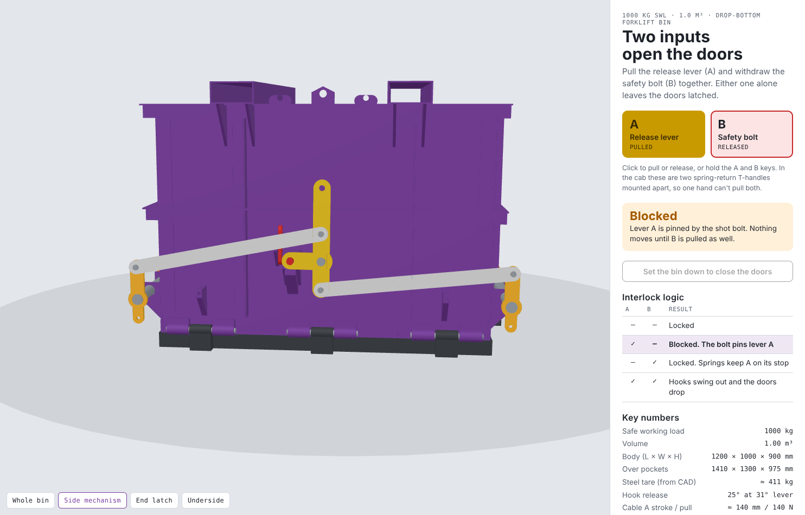
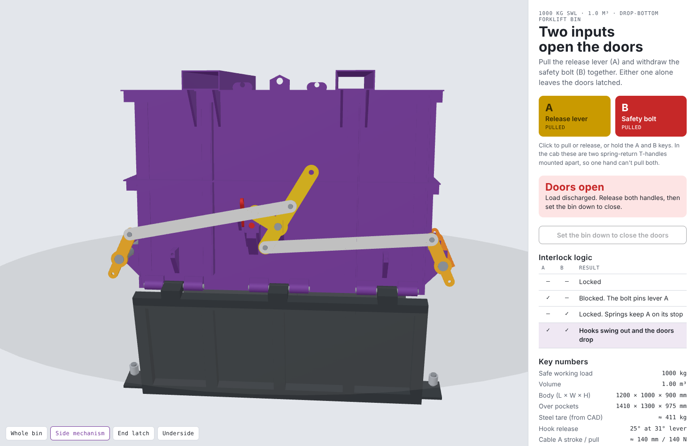
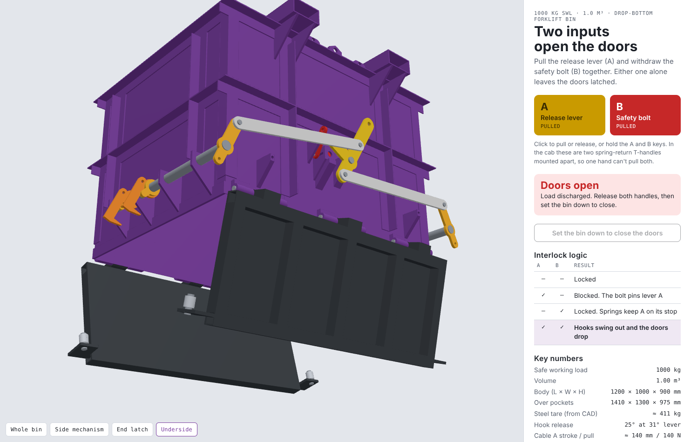
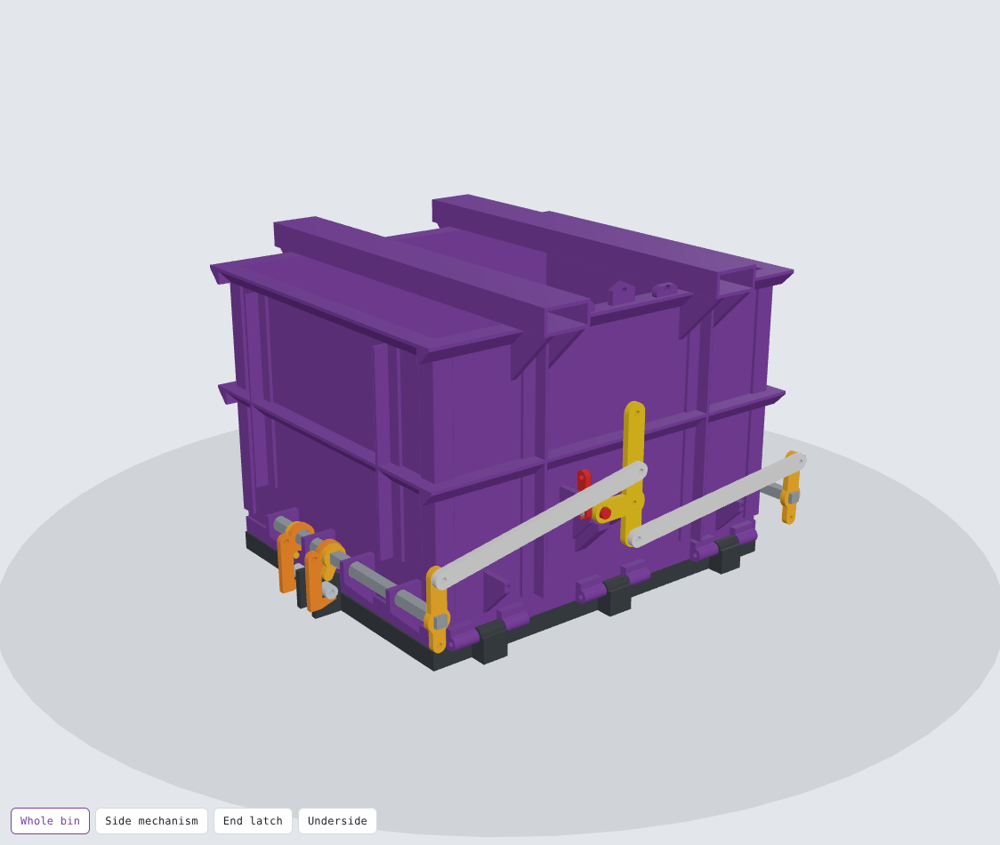
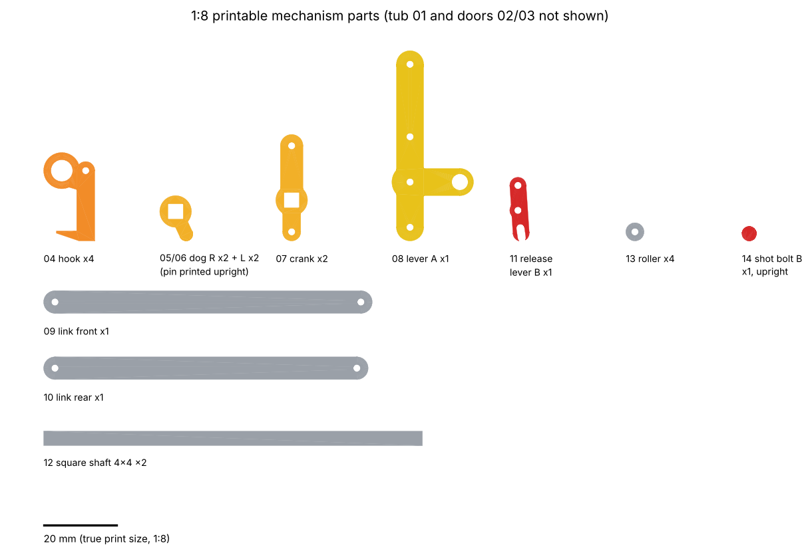

# 1-Tonne Drop-Bottom Forklift Bin with a Two-Input Door Release

This is a parametric design built from `1-Tonne_Drop-Bottom_Forklift_Bin_Design.md`. One CadQuery model generates both outputs:

| Output | Where | Scale |
|---|---|---|
| Steel fabrication pack (STEP assemblies + weldments, 1:1 DXF cutting profiles, cut list, plate list, bought-out list) | `fab/` | 1:1, mm |
| 3D-printable working model (STL files, already in print orientation) | `print/stl/` | 1:8 |
| Renders | `renders/` | |
| Interactive 3D viewer (pull A and B and watch the latch work) | `viewer/` | |



## What "two inputs" means here

The doors open only when **both** inputs are pulled **at the same time**:

| Input A (release lever) | Input B (safety bolt) | Result |
|:-:|:-:|---|
| – | – | **Locked.** Hooks sit under the door rollers, and the shot bolt pins lever A. |
| ✓ | – | **Blocked.** Lever A cannot turn because the bolt passes through it. Nothing moves. |
| – | ✓ | **Locked.** The bolt is withdrawn, but the return springs keep lever A on its stop. The hooks stay under the rollers, held there by their own self-locking geometry. |
| ✓ | ✓ | **Release.** Lever A turns 31°, both cross-shafts turn, all four hooks swing 25° clear, and gravity drops the doors. |

* **Input A** is a cable on the central lever (yellow). The stroke is about 140 mm and the pull is about 140 N.
* **Input B** is a cable on the release lever (red). It withdraws a Ø25 hardened shot bolt by 30 mm against its spring.
* In the cab, use two spring-return T-handles mounted far enough apart (≥ 300 mm, or one on each side of the seat) that one hand can't pull both.
* **Sequence matters.** If B is pulled and let go before A, the bolt springs back into the lever and A stays blocked. Both handles have to be held together.
* **It fails safe.** A broken cable leaves the bin locked. A broken bolt spring takes the bin down to single-input (A) operation, but the hooks still self-lock. The daily pre-use check (below) catches this.

### Latch details (each end wall)

 

* Each door has a **lug at both ends**. Each lug carries a **Ø25 pin and a Ø40 roller**, giving four rollers in total.
* A **cross-shaft** (Ø40) runs along each end wall in four gusset bearings. It carries one **hook** per door.
* **The hooks self-lock.** The roller sits 3 mm *outboard* of the hook pivot. The door's weight therefore drives the hook further shut, not open. Vibration or impacts can't shake it loose.
* **The hooks are gravity-biased and free on the shaft.** A keyed **drive dog** pushes each hook open, but only in the opening direction. That lets a closing door cam a hook aside without moving the shaft, the lever or the bolt.
* **The bin re-latches when set down.** Lower the empty bin onto the ground. The doors are pushed up, each roller hits the sloped lead-in face under its hook toe (first contact at about 7° of door angle), and the hook swings out and drops back under the roller.

### Side mechanism (+Y wall, the forklift side)





* Each shaft has a crank at its +Y end, joined to the central lever by a link (front crank to the upper lever arm, rear crank to the lower arm). Both links are in tension during release.
* Each crank has a return spring (anchor bracket on the wall). A stop block under the lever lobe sets the locked position.
* The shot bolt runs in a bored housing welded to the wall. A cross pin passes through slots in the housing to the fork of the release lever, which pivots on its own bracket.



## Changes from the original spec

* **Two-input interlock.** The spec had a single cable and latch. The interlock above replaces it.
* **Hooks instead of a sliding catch.** They self-lock under load and re-latch automatically. That gives a low release force (about 140 N at the handle) even with a full tonne on the doors, because the rollers take the friction.
* **Fork pockets** are 1300 mm long, 150 mm past each side wall, at 600 mm centres, with 45° gussets. This keeps the side mechanism inside the pocket ends so the forklift carriage can't hit it.
* **Wall bracing** uses the spec's angle-iron option instead of corrugation: a top rim, a mid band at 480–530 mm, vertical stiffeners and corner posts, all 50×50×5. Vertical members start 130 mm above the ground so the opening doors clear them.
* **Tare weight.** The spec estimated 180–220 kg. The CAD model weighs **≈ 411 kg** (tub 236 kg, each door 68 kg; see `fab/mass_summary.txt`). Most of the difference is the door framing, the angle bracing and the 150×75 RHS pockets. Weight-saving options: press-braked corrugated walls instead of angles, 5 mm door plate, 50×25 RHS door cross members. Add the real tare to the SWL plate and the forklift capacity check.

## Engineering checks (hand calcs; verify before building)

Load case: 1000 kg on the doors with a ×2 dynamic factor (forklift travel), giving 19.6 kN. Per door that is 9.8 kN. Half goes to the hinge line and half to the free edge (4.9 kN), shared by two rollers, so **2.45 kN per roller**.

| Item | Check | Result |
|---|---|---|
| Ø25 roller pin (EN8), cantilever 29 mm | M = 71 N·m, σ = 46 MPa | OK (yield ≥ 280) |
| Hook arm 40×12, load 43 mm eccentric | σ = 5 + 33 = 38 MPa | OK |
| Hook toe 22×12 cantilever 23 mm | σ = 58 MPa, τ = 9 MPa | OK |
| Ø40 cross-shaft, 200 mm bearing span | σ = 18 MPa; torque ≈ 0 (load passes 3 mm off centre) | OK |
| Ø20 hinge pins, double shear, 1.63 kN each | τ = 2.6 MPa | OK |
| Door free edge SHS 50×50×5, span 1230 mm | σ = 61 MPa, static deflection ≈ 0.9 mm | OK |
| Shot bolt Ø25 if A is yanked at 1 kN without B | 2.6 kN shear → 5 MPa | OK |
| Handle force for A | 2 × (≈ 6 N·m per hook) + springs → ≈ 140 N | within normal T-handle effort |

These are first-pass hand checks. Before the bin goes into service, a **competent engineer must review it**: the pocket welds and the lift path (1.41 t gross), the wall plates under bulk pressure, and the weld sizes. It then needs a **proof-load test** (for example 1.25–1.5 × SWL, as your local lifting-equipment rules require), a stamped SWL / tare plate, and an inspection record.

## Fabrication notes

1. **Tub.** Tack the 3 mm walls (sides are full 1200 mm, ends fit between). Add the rim and band angles, the vertical stiffeners and corner posts, then the 50×8 flat bars on the end-wall bottom edges. Fully seam weld.
2. **Fork pockets.** RHS 150×75×5 × 1300 on the rim at ±300 mm, plus 4 gussets per pocket. Use multi-pass fillets, because this weld carries the whole bin.
3. **Hinges.** Three per door at x = −450 / 0 / +450. The axis sits 22 mm outside the side wall and 20 mm above the floor line. Tub knuckles are welded to the wall with tabs; door knuckles sit on leaves under the door frame. Weld the tub knuckles with a full-length Ø20 alignment bar through all of them.
4. **Doors.** 6 mm plate on a 50×50×5 SHS frame (perimeter + 3 cross members), 1230 × 495 mm. Weld a 12 mm lug (`door_lug` DXF) to each end of the free-edge member and fit the Ø25 pin, the Ø40 roller and a washer with a split pin.
5. **Cross-shaft bearings.** Four gussets per end wall at y = −200 / 0 / 200 / 420. Tack them, **line-bore Ø42 through all four with the shaft centre 667 mm from the bin centre and 200 mm above the ground**, then weld out.
6. **Shafts.** The cranks and drive dogs are welded or keyed to the shaft. The hooks run free on the shaft (Ø42 bore, grease nipple). Press the Ø16 drive pin into each dog. With the doors closed, the hook arm must rest on that pin.
7. **Side mechanism.** Fit the lever pivot post, the bolt housing (bore Ø26 blind, 10 mm slots for the cross pin), the stop block, the release-lever bracket and the spring anchors, using the positions in `fab/step/tub_weldment.step`. Then fit the lever, links, cranks, springs, bolt, bolt spring, cross pin and release lever.
8. **Cables.** Run cable A from the lever eye through a sheave toward −X and up to the cab. Run cable B from the release-lever eye (pull toward +Y) through the rim eye to the cab. Use different handle colours (yellow A, red B) to match the decals.
9. **Finish.** Prime and topcoat. Add crush-hazard decals at both door hinge lines and at the hooks, plus "TWO-HANDED RELEASE: A + B" next to the lever.

### Commissioning / daily pre-use check
- Pull **A only**: the lever must not move.
- Pull **B only**: the doors must stay shut.
- Release both: the bolt must snap fully into the lever.
- Set the empty bin down and lift it: all four hooks must be under their rollers.
- Load test empty, then 250 / 500 / 1000 kg, as the original spec says.

## 3D-printable model (1:8)




The printable model is a working version of the same mechanism. All plates are at least 2.4 mm thick, walls are 1.6 mm, every overhang is 45° or less, and pivots use 1.75 mm filament as pins.

| File | Qty | Notes |
|---|---|---|
| `01_tub_x1.stl` | 1 | Print upright, open bottom down. 175 × 163 × 115 mm, so it fits a 220 mm bed. No supports. |
| `02_door_RH_x1.stl`, `03_door_LH_x1.stl` | 1 + 1 | Print frame-side down |
| `04_hook_x4.stl` | 4 | Flat. Round bore, free on the shaft |
| `05_dog_R_x2.stl`, `06_dog_L_x2.stl` | 2 + 2 | Flat, pin upright. Square bore keys to the shaft |
| `07_crank_x2.stl` | 2 | Flat, square bore |
| `08_lever_A_x1.stl` | 1 | Flat |
| `09_link_front_x1.stl`, `10_link_rear_x1.stl` | 1 + 1 | Flat |
| `11_release_lever_B_x1.stl` | 1 | Flat |
| `12_square_shaft_x2.stl` | 2 | Lying flat. Or use 4 mm square brass/steel rod |
| `13_roller_x4.stl` | 4 | Upright |
| `14_shot_bolt_B_x1.stl` | 1 | Upright, chamfered end up |

**Settings:** PETG or PLA, 0.4 mm nozzle, 0.12–0.16 mm layers, 3–4 perimeters. Use 100 % infill for the small mechanism parts.

**Hardware:** 1.75 mm filament for every pin (hinges, link pins, lever pivot, release pivot, roller axles, bolt cross pin). Mushroom the pin ends with a soldering iron or a drop of CA glue. Small rubber bands serve as the two crank return springs, and a short piece of ballpoint-pen spring goes behind the shot bolt.

**Assembly:**
1. Hinge both doors to the tub with filament pins.
2. Thread each square shaft through the four end-wall gussets, adding the hooks (free) and dogs (keyed) as you go. Fit the crank on the +Y end.
3. Fit the rollers to the door lugs on filament axles.
4. Fit the bolt with its spring into the housing. Push a filament cross pin through the housing slot, then fit the release lever on its bracket with its slot over the cross pin.
5. Fit lever A on its post with the bolt through its lobe hole. Pin on the links, then hook rubber bands from the crank tails to the spring anchors.

Optional: the model also works at 1:5 if you have a 260 mm bed. Set `PRINT_SCALE = 1 / 5` in `cad/bin_model.py` and re-run `export.py`.

## Regenerating everything

```bash
pip install cadquery ezdxf matplotlib
cd drop-bottom-bin/cad
python3 checks.py fab && python3 checks.py print   # interference + mechanism checks
python3 export.py                                   # STEP, DXF, CSV, STL, parts sheet
python3 export_web.py fab && python3 export_web.py print
cd ../.. && npm install && node drop-bottom-bin/cad/render_views.mjs   # PNG renders
```

All dimensions are parameters in `FAB` at the top of `cad/bin_model.py`. Change them and re-run.

`checks.py` verifies, for both the steel and the printed model:
* zero part-to-part interference with the doors closed and locked, and fully released;
* the door swing from 0° to 90° clears the released hooks;
* a closing roller first touches the locked hook on the lead-in chamfer;
* the self-lock offset is positive and each hook's centre of gravity is outboard of its pivot.
